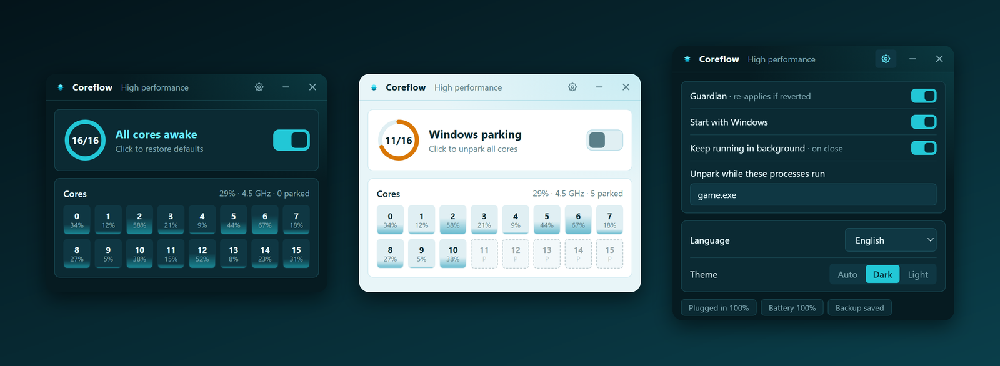
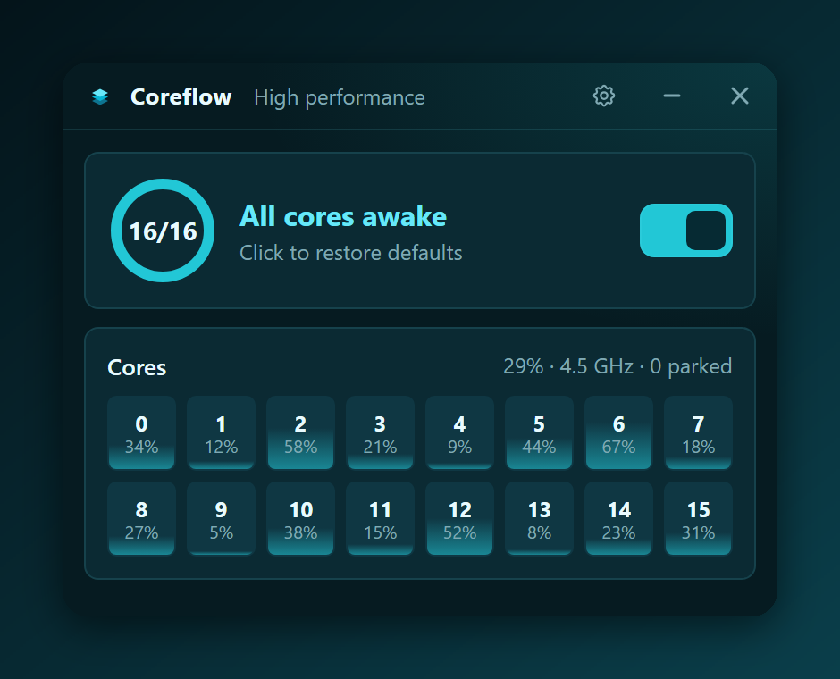
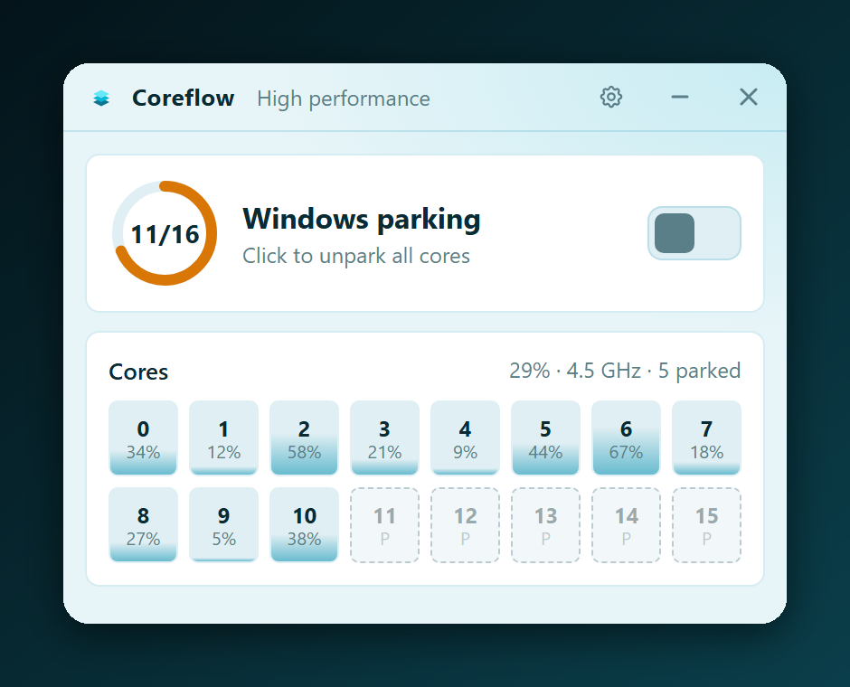
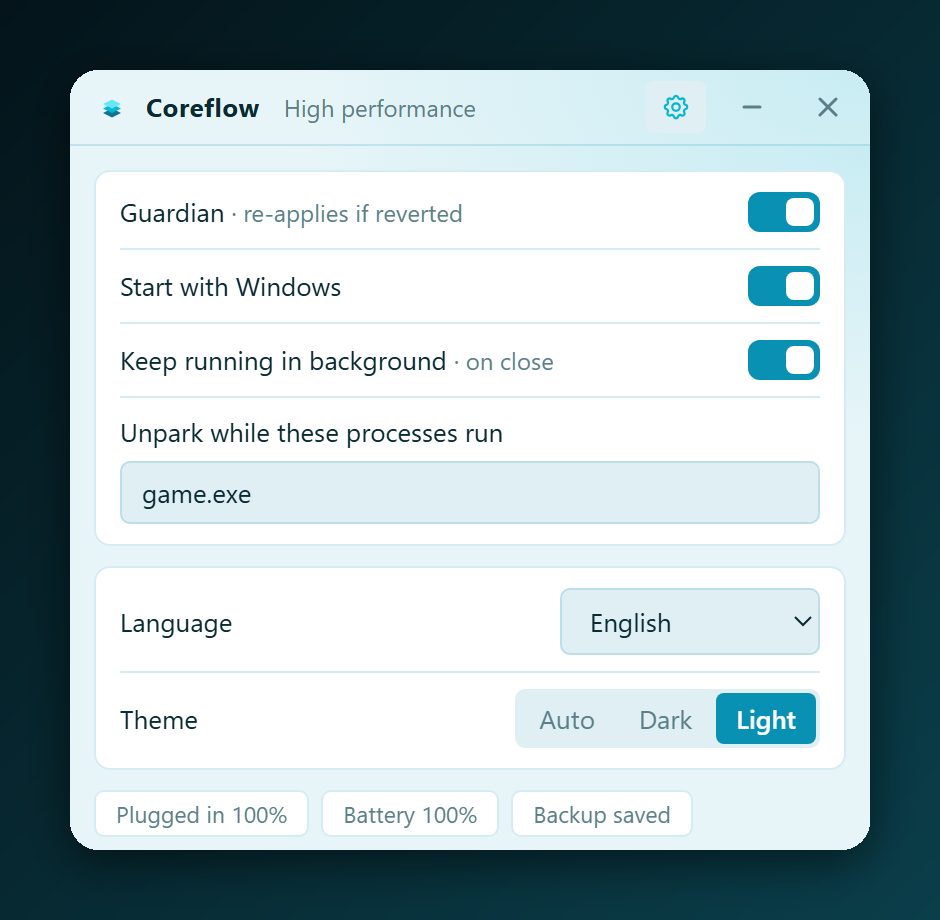
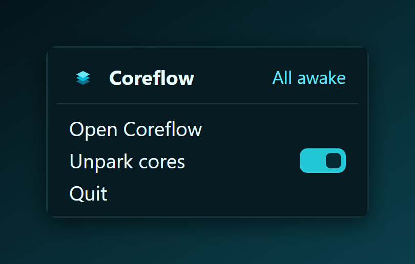

<div align="center">


# Coreflow

**Unpark your CPU cores in one click.**<br>
A tiny, fast Windows tray app that keeps every core awake — with a clean, modern interface.




</div>

---

## Why

Windows *parks* idle CPU cores (puts them into a deep sleep state) to save power. Waking a parked core
costs latency, which can show up as stutter in games and slower reaction in bursty workloads.
Coreflow flips the hidden power-plan switch that controls this, shows you what every core is doing
right now, and keeps the setting in place.

> Unparking does not make a CPU faster by itself. It removes wake-up latency, and costs some power and heat.
> Measure before you believe anyone's FPS claims, including ours.

## Features

- **One-click unpark**, with a backup of your original values and a one-click restore.
- **Live per-core view**: usage, frequency and parked state for every logical core.
- **Guardian**: re-applies the setting if Windows or an OEM tool reverts it.
- **Per-process rules**: unpark only while `game.exe` (or anything you list) is running.
- **Tray app with a themed menu**, opens instantly and stays out of your way.
- **Light on resources**: about 2 MB of RAM and no measurable CPU while idle in the tray (measured on the author's machine).
- **Starts with Windows** (hidden in the tray) and can keep running in the background after you close the window.
- **Dark and light themes**, plus 6 languages: English, Español, Português, 中文, 日本語, 한국어.
- **Command line** for scripts: `coreflow --on`, `--off`, `--status`.
- No telemetry, no network access, no administrator rights needed in our testing.

## Screenshots

| Dark | Light, Windows parking active |
|---|---|
|  |  |

| Settings | Tray menu |
|---|---|
|  |  |

The screenshots show the real interface rendered with sample data.

## How it works

Windows exposes core parking as hidden settings of the active power plan (subgroup `SUB_PROCESSOR`):

| Setting | Alias | GUID | Value |
|---|---|---|---|
| Minimum parked cores | `CPMINCORES` | `0cc5b647-c1df-4637-891a-dec35c318583` | `100` disables parking |
| Same, second core class (hybrid CPUs) | `CPMINCORES1` | `0cc5b647-c1df-4637-891a-dec35c318584` | `100` disables parking |

Coreflow reads and writes them through the Windows power API (`PowerReadACValueIndex`,
`PowerWriteACValueIndex` and their `DC` variants, then `PowerSetActiveScheme`), so no `powercfg` process is
spawned. Both the plugged-in and on-battery values are handled. Before the first change it stores your
original values in `%APPDATA%\unpark-cpu\backup.json`, one entry per power plan. The guardian never
"restores" a plan it has no backup for.

Live core data comes from the Windows performance counters (`Processor Information`:
`% Processor Utility`, `Processor Frequency`, `Parking Status`).

## Install

Download `Coreflow_0.1.0_x64-setup.exe` from the [latest release](https://github.com/VuloB1/coreflow/releases/latest).
The installer is unsigned, so Windows SmartScreen may warn you the first time you run it.

### Build from source

**Requirements:** Windows 10/11 x64, [Rust](https://rustup.rs/) (stable) with the MSVC build tools, and the
WebView2 runtime (already part of Windows 11).

```bash
git clone https://github.com/VuloB1/coreflow
cd coreflow
cargo run --release
```

To build an installer (needs Node.js for the Tauri CLI):

```bash
npx @tauri-apps/cli@2 build --bundles nsis
```

## Command line

```text
coreflow --status    print the active plan and whether cores are unparked
coreflow --on        unpark all cores (the guardian keeps it that way)
coreflow --off       restore the values saved before the first change
```

## Settings

Open the gear icon in the title bar:

| Option | What it does |
|---|---|
| Guardian | Re-applies the unpark setting if it gets reverted (checked every 5 seconds) |
| Start with Windows | Launches hidden in the tray at sign-in |
| Keep running in background | On close, the app stays in the tray. If off, closing the window quits Coreflow |
| Unpark while these processes run | Comma-separated executable names, e.g. `game.exe, render.exe` |
| Language / Theme | Auto follows your system |

Settings are stored in `%APPDATA%\unpark-cpu\config.json`.

## Limitations

- Windows only lets you choose a **percentage per core class**, not individual cores to park.
- On Windows 11 with hybrid CPUs (P/E cores) the OS scheduler has the last word. Coreflow also writes
  `CPMINCORES1`, but this has **not been tested on a hybrid CPU**.
- Tested on Windows 11 with an AMD Ryzen 7 5700X only. Reports from other setups are welcome.
- On laptops, unparking raises power draw and temperature. Use it plugged in.
- Power plan changes, driver updates or OEM utilities can revert the setting. That is what the guardian is for.

## Translations

All strings live in [`ui/i18n.js`](ui/i18n.js). To add a language, copy one block, translate it and add it to `LANGS`.

## Project layout

```text
src/main.rs     app shell: tray, windows, commands, CLI
src/power.rs    power-plan read/write, backup and restore
src/guard.rs    config, per-process rules and the guardian loop
src/cpu.rs      live per-core data and memory trimming
ui/             HTML/CSS/JS front end (no build step)
```

## Safety

Coreflow only changes the two parking values above on your user's power plans, and keeps a backup next to
its settings. If anything looks off, press the switch again, run `coreflow --off`, or reset the plan with
`powercfg /restoredefaultschemes`. Use at your own risk.

## License

[MIT](LICENSE)
